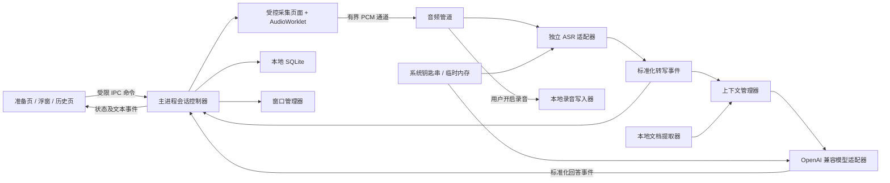

# 自有 API 实时助手设计文档

日期：2026-10-11  
状态：设计草案，待用户审阅；尚未实施。  
依据：Realtime Copilot 0.1.15 的发布包分析、授权运行观察、隔离边界测试及用户反馈。

## 1. 目标与已确认的需求

制作一个可独立运行的桌面实时助手：采集用户选择的音频，实时显示转写，把选定的会话上下文交给用户配置的模型，流式展示回答。客户端不依赖原产品的账号、充值、额度、会话创建或云存储服务。模型和 ASR 服务产生的费用仍由所选服务商决定。

用户已确认：

- 模型使用自己的 OpenAI 兼容接口。
- **实时转写独立配置 ASR 服务**，不要求模型接口同时支持音频。
- 重点使用场景是腾讯会议共享整个屏幕，同时本机继续查看助手浮窗。
- 当前先交付设计文档，以已经获取的内容为依据。

本草案建议首版只支持 macOS，优先适配当前 arm64 设备；使用 Electron、TypeScript 和 React。技术栈、首版范围及默认行为是设计建议，尚不等同于用户已批准实施。

成功标准是完成“自有服务配置 → 音频转写 → 上下文生成 → 浮窗显示 → 停止并保存”的独立流程，并能明确反馈权限、连接和共享保护状态。目标是重建可用功能；现有证据不能支持原后端、原回答质量或所有共享场景的完全一致保证。

## 2. 证据与可恢复边界

| 内容 | 当前证据 | 对设计的影响 |
|---|---|---|
| 原客户端技术 | 安装包包含 Electron 主进程、preload 和渲染代码；框架声明版本 33.4.11 | Electron 是接近现有行为且便于复现的路线；新项目版本另行选定 |
| 浮窗与内容保护 | 原代码有 panel、置顶、跨工作区及 `setContentProtection` 调用 | 窗口显示策略和采集保护必须分别设计 |
| 腾讯会议共享 | 用户反馈“我自己可以看到，别人看不到” | 保留为人工观察；没有独立接收端帧证据，不写成全面验证通过 |
| 音频与实时转写 | 实际运行采集到 PCM 数据及临时、确认转写，界面完成转写和回答 | 可以重建实时链路；没有字错率、串音率和延迟基准 |
| 原流式回答 | 实际捕获顶层 `token` 和完成事件；人工 `choices/delta` 事件不被原解析器消费 | 自有模型需要新的标准协议适配器 |
| 录音保存 | 原运行出现 writer_ready、saved 确认及关闭 | 独立客户端改成本地写入，保留明确的保存完成状态 |
| 失败边界 | 隔离执行原声明复现停止后重连、保存等待不结束、失败帧未重入队等问题 | 不照搬生命周期逻辑，明确取消、队列与终态规则 |
| 文档提取 | 简单 PDF/DOCX 成功，损坏输入返回错误 | 可设计文本导入；复杂中文排版、扫描件和旧 DOC 另有边界 |
| 后端能力 | 未获取原模型配置、完整服务端提示词和知识库实现 | 自行设计提示词和上下文，不声称已恢复这些内部算法 |

本地依据：

- [最终边界核查报告](../../../realtime-copilot-analysis/最终边界核查报告.md)
- [新账号限时验证报告](../../../realtime-copilot-analysis/新账号限时验证报告.md)
- [逆向分析报告](../../../realtime-copilot-analysis/逆向分析报告.md)
- [第二轮补充分析](../../../realtime-copilot-analysis/第二轮补充分析.md)
- [文本生成运行验证](../../../realtime-copilot-analysis/文本生成运行验证.md)

上述内容是设计输入，不是新应用已经完成的验证结果。新产品使用自行编写的代码；提取的原发布代码只作为行为分析材料，不作为交付工程的源文件或运行依赖。

## 3. 路线比较与建议

| 路线 | 优点 | 主要代价 | 结论 |
|---|---|---|---|
| **独立 Electron 客户端** | 能保留桌面浮窗交互；模型、ASR 和本地存储边界清楚；可复用已观察的行为经验 | 需要重新编写界面、采集和服务适配；macOS 共享保护仍需实测 | **推荐** |
| 原客户端配兼容网关 | 可以较快复用已有界面和私有事件格式 | 登录、额度、业务协议和版本更新耦合；修改包还涉及签名与维护 | 不作为本项目路线 |
| 原生 Swift 客户端 | 便于直接管理 macOS 窗口和音频能力 | 全部界面和交互重写；跨平台成本更高；原生实现也不能自动保证采集排除 | Electron 原型遇到明确平台瓶颈后再评估 |

推荐路线让客户端直接访问用户指定的模型与 ASR，不额外建立业务后端。一个本地会话控制器协调各模块，避免先建设账号、计费、云同步等与当前目标无关的系统。

## 4. 首版功能范围

| 首版包含 | 行为要求 |
|---|---|
| 模型配置 | Base URL、API Key、模型名；连接测试；流式回答；明确显示错误 |
| 独立 ASR 配置 | 服务适配类型、端点、鉴权配置、语言及服务要求的音频参数；分别测试 |
| 会话准备 | 音频来源选择、可编辑的任务说明、导入资料、录音保存开关 |
| 音频输入 | 麦克风、系统音频、二者同时；无法采集时显示实际可用能力 |
| 实时转写 | 临时结果可更新；确认结果保留来源、时间和片段标识 |
| 回答生成 | 手动输入/选中转写提问；可开启基于确认转写的自动建议；流式显示和取消 |
| 浮窗 | 持续置顶、展开/收起、显示/隐藏、可配置快捷键、内容保护开关 |
| 本地会话 | 保存转写、回答、资料引用和状态；查看与删除；导出文本 |
| 可选录音 | 用户开启后保存本地音频，显示保存中、已保存或保存失败 |
| 文档 | TXT、DOCX、可提取文字的 PDF；先预览提取内容再确认加入会话 |

首版不包含知识库检索系统、扫描件 OCR、旧版 DOC、截图多模态问答、翻译模式、云账号/同步、支付、自动更新以及 Windows/Linux。资料导入采用文本上下文，不把它命名为已经实现了原知识库。

## 5. 架构与数据流

主进程持有密钥、网络连接、文件写入和会话权威状态。界面只提交白名单命令并接收事件。采集页面只负责受授权的设备输入及 PCM 处理，不访问服务密钥；AudioWorklet 处理音频，网络与存储不放入音频回调。

| 模块 | 输入 / 输出 | 职责边界 |
|---|---|---|
| 会话控制器 | start/stop/cancel；状态事件 | 生命周期、资源所有权、取消与超时 |
| 音频管道 | 原始音频；带序号的 PCM 帧 | 来源分离、持续重采样、限流与中断标记 |
| ASR 适配器 | PCM；标准转写事件 | 服务鉴权、协议、结束和恢复策略 |
| 上下文管理器 | 确认转写、资料、任务说明；消息快照 | 预算、来源、自动建议触发与截断 |
| 模型适配器 | 消息快照；增量/完成/失败事件 | OpenAI 兼容 HTTP/SSE 和请求取消 |
| 录音写入器 | PCM；文件完成或失败事件 | 本地落盘、文件头、临时文件与恢复 |
| 窗口管理器 | 模式与偏好；实际窗口状态 | 置顶、焦点、保护和快捷键 |
| 文档提取器 | 用户选择的文件；文本和解析状态 | 本地提取、大小限制、错误报告 |

采用可替换模块接口，但首版只要求一个真正可用的实时 ASR 服务适配器和一个 Chat Completions 模型适配器。不会为每家服务商预先建设复杂插件框架。

## 6. 模型与 ASR 接口契约

### 6.1 OpenAI 兼容模型

首版支持 Chat Completions 的文本能力。Base URL 定义为 API 前缀，例如 `https://example.com/v1`；适配器追加 `/chat/completions`，不重复追加 `/v1`。配置预览显示最终请求地址，模型名由用户填写；不自动推断服务商或模型能力。

请求使用 `model`、`messages` 和 `stream: true`；密钥通过请求头传递。按标准解析 SSE 的 `choices[0].delta.content`，处理空 choices、完成原因及服务支持的结束标记。角色或空增量不生成空白消息；usage 可缺省。SSE 解码必须跨网络分块保留 UTF-8 和事件缓冲，不能以一次读取当作一个事件。[OpenAI 流式事件参考](https://developers.openai.com/api/reference/resources/chat/subresources/completions/streaming-events)

内部事件统一为 `answer.delta`、`answer.completed`、`answer.failed`、`answer.cancelled`，都携带 sessionId、generation 和 requestId。每次请求只能进入一次终态。连接结束但没有符合该服务契约的完成信号时，标记为中断并保留已收到的内容。

连接测试只发送小型文本请求，展示响应是否符合契约。若服务拒绝流式模式，可通过显式非流式选项使用完整响应；不悄悄更换端点。首版不承诺 Responses API、工具调用、图像或不同服务商的自定义推理事件兼容。

取消使用 AbortController，并立即将本地请求标记为取消。界面明确“已停止接收”，不能据此声称服务端计算或计费必然停止。自动重试只适用于尚未收到内容的临时错误，最多一次；已开始输出的请求由用户决定是否重新生成。

### 6.2 独立实时 ASR

“OpenAI 兼容”在本设计中只约束模型接口，不意味着任意 ASR WebSocket 都互通。每个实际 ASR 服务需要适配其握手、音频编码、结果字段、结束信号及鉴权；钥匙、签名或短期令牌均在主进程处理。

用户尚未指定 ASR 服务商。这不影响其余模块设计；**接入真实音频的前置条件是选定一个服务，核对其公开协议、凭据和双路音频能力，并完成该适配器的实网验收**。模拟服务只能验证内部流程，不能代替这一条件。界面只列出实际实现的适配类型，不提供一个声称支持所有服务的通用 WS 地址输入框。

标准化转写事件字段：

| 字段 | 约定 |
|---|---|
| sessionId / generation | 会话身份与本次运行代次 |
| sourceId | `microphone` 或 `system`；不是说话人身份 |
| streamEpoch | 每次重新连接递增，区分不同流的片段编号 |
| segmentId / revision | 服务片段编号及修订次数；缺失时由适配器生成稳定编号 |
| text / isFinal | 当前片段文字；是否确认结束 |
| startMs / endMs | 会话音频时间轴上的毫秒值；无法可靠得到时为空 |
| receivedAt | 本地事件接收时间，不冒充音频发生时间 |

同片段修订更新原记录，确认后进入上下文。去重依赖服务编号、流代次和已声明的重放语义，不按“文字相同”删除正常重复发言。原 ASR 的时间字段与毫秒相符属于运行推断，新适配器必须核对自身协议后转换。

鉴权失败、明确余额不足等不可恢复错误不自动重连。连接建立超时默认 10 秒；临时网络错误最多连续重试三次，退避 1/2/4 秒并加入小幅随机扰动。只在持续稳定接收 30 秒后重置连续失败预算。断线期间不无限缓存；首版默认新建流并标记转写缺口，不假设服务支持无缝续传。适配器只有在服务明确支持重放去重时才启用短缓冲重发。

## 7. 音频采集与录音

麦克风和系统音频采用独立来源流，分别转写并标记来源，避免把系统声音同时放入混音与旁路转写造成重复上下文。硬件回声或麦克风收进扬声器仍可能造成重复，不能承诺自动说话人分离。耳机及实际串音测试属于音频验收。

双路模式要求 ASR 适配器支持两条并发输入；若服务或套餐不支持，启动前提示并让用户选择单路，不能默默混音。系统音频先验证 Electron 在选定 macOS 版本的支持与授权流程；若必要能力不可用，应如实禁用该输入。原生采集扩展属于明确平台瓶颈后的单独设计变更。

内部默认格式为单声道 16 kHz PCM16；适配器如果要求不同格式，由边界层转换。不得把浏览器请求的采样率当作实际输入采样率。连续重采样保留跨帧相位/余数，并做抗混叠处理，避免逐块舍入累积；每帧携带 sourceId、sequence、startSample 和 sampleCount。

输入到网络的缓冲默认上限为每来源 5 秒音频。网络背压达到上限时丢弃最旧未发送帧，并生成可见的缺口事件；不堵塞实时采集，也不无限增加内存。重新发送的条件和顺序由 ASR 服务契约约束。录音走独立队列，网络丢帧不能静默删除本地录音。

录音默认关闭。用户开启后，各来源分别写入本地临时 PCM 文件，结束后流式封装 WAV，不把整场音频保存在内存。录音写入队列上限为每来源 10 秒；磁盘写入跟不上或空间不足时停止录音并显示失败，保留可恢复片段，转写可继续。每分钟记录文件长度检查点；大于 WAV 单文件容量限制前滚动到下一文件，首版以每文件最长 60 分钟为切分规则。

保存完成以本地文件关闭及封装结果确认；保存失败不会显示“已保存”。进程异常退出后的临时文件在下次启动列入恢复列表，用户可恢复或删除。

## 8. 上下文与回答策略

上下文依次包含自行设计的任务说明、用户确认的资料文本、近期确认转写、当前问题以及有限的回答历史。转写和导入文本作为引用资料，不能改变系统指令。临时转写只显示，不触发模型请求；每次请求使用不可变消息快照，回答不会被后到的转写偷偷修改。

每个模型配置须包含输入预算和输出上限。首版采用保守长度估算并留 20% 余量；它不是服务端精确 token 数。裁剪顺序先移除较早回答，再移除较早转写，最后限制资料长度；保留当前问题和任务说明。界面展示资料截断/历史省略提示。服务仍返回上下文过长时终止该次请求，提示调低预算，不无限重试。

手动提问为默认模式。可开启自动建议：确认片段后等待 1.5 秒稳定窗口，对积累的新文本形成候选；已有自动请求执行时只保留一个最新候选，不建立无限队列。手动请求优先，会取消当前自动回答；开启自动模式不保证每句话都值得回答，用户可暂停并按需生成。

每个候选记录其转写版本范围，防止同一批片段反复生成。旧请求取消或会话代次改变后，其迟到增量不能写入当前回答。具体任务模板可编辑；模板质量需要独立样本评估，现有证据没有恢复原服务的完整提示词。

## 9. 会话生命周期与异常收敛

主状态：`idle → starting → running → stopping → stopped`。启动失败进入 failed；failed 经过资源清理后可返回 idle。ASR、模型和录音各有独立子状态，ASR 重连时显示 degraded，不能因此重新启动整个会话或录音设备。

启动先校验配置和权限，再建立采集与 ASR；只在至少一个用户选定来源准备成功后进入 running。双路部分失败时先说明不可用来源，用户选择继续单路或结束。手动文本模式可在没有 ASR 的情况下单独使用。

停止顺序：

1. 进入 stopping，禁止新回答；递增 generation，取消重连计时器与模型请求。
2. 先停采集，读取最后一段 PCM；为关闭流程保留独立的 drain 身份，只接纳此次停止产生的最终结果。
3. 各 ASR 适配器执行其结束协议，最多等待 3 秒确认结果，超时则标记转写可能不完整并关闭。
4. 录音队列落盘和封装最多等待 10 秒；超时进入保存失败，保留恢复文件。
5. 保存会话终态并释放所有资源。任何关闭、失败、取消和超时路径都必须结束等待 Promise。

旧会话数据、停止后的重连回调和普通迟到消息统一拒收；drain 白名单只允许停止流程需要的最终转写和保存结果，不允许重启采集。重复 stop 为幂等操作。结束过程中退出应用应显示仍在保存，并允许用户选择等待或退出并保留恢复文件。

| 故障 | 首版处理 |
|---|---|
| 权限拒绝或设备移除 | 显示具体来源错误；停止该来源，保留其他来源及已有记录 |
| ASR 临时断线 | 有限重连、缺口标记；停止后绝不重新连接 |
| ASR 1008 等关闭 | 根据供应商契约分类，不简单把所有同代码当成可重试 |
| 模型 401 / 429 / 5xx | 分别提示配置、限流、服务异常；不影响音频采集 |
| SSE 中断或 JSON 非法 | 保留部分回答并标记异常；不以零内容误报成功 |
| 录音保存失败 | 显示文件状态和恢复路径，不阻塞转写结束 |
| SQLite 写入失败 | 标记历史未保存，保留内存文本并提供导出，不声称已落盘 |
| 窗口保护状态异常 | 显示设置状态与测试状态的区别，不自动给出“共享安全”保证 |

## 10. 浮窗、共享保护与界面

准备/设置页使用普通窗口；实时助手使用独立浮窗，展开与收起保持同一窗口身份。本机置顶、跨工作区和全屏显示由窗口管理器协调；点击腾讯会议等其他窗口后不自动隐藏助手。显示/隐藏只由明确按钮或快捷键控制。浮窗拖动、大小和透明度保存为本地偏好。

浮窗默认请求内容保护，并在窗口重建、模式切换和显示时重新应用。用户可显式关闭以展示助手内容，界面持续显示保护开关状态。设置窗口和历史窗口也可含敏感文字，提供同一保护选项；不会因为浮窗开了保护而宣称所有窗口都受保护。

**置顶解决本机可见；内容保护尝试限制外部采集。这是两个独立能力。** 原产品在准备页关闭置顶，能解释被其他窗口覆盖的可能性，不能据此判断共享排除是否工作。

Electron 官方说明 macOS 内容保护使用 NSWindow sharingType，但一些采用 ScreenCaptureKit 的应用仍可捕获窗口。因此 `isContentProtected()` 返回 true 只表示设置开启，不能作为接收端验证结果。[Electron 内容保护说明](https://www.electronjs.org/docs/latest/api/browser-window#winsetcontentprotectionenable-macos-windows)

腾讯会议整屏共享是首个必须验证的场景：本机持续看见浮窗，同时由独立接收端确认共享画面是否包含浮窗。记录系统、Electron、会议软件版本及共享方式，分别验证失焦、展开收起、全屏、跨工作区和重新共享。只有该组合通过才能标为“该环境实测通过”；其他组合保持“未验证”。如果独立客户端无法排除采集，必须记录该限制并评估替代窗口方案，不能通过简单更换技术栈宣称保证解决。

界面包括准备页、实时浮窗和本地历史页。浮窗优先展示最新回答，另有转写区域、麦克风/系统输入状态、ASR/模型连接状态、停止按钮以及保存结果。配置测试和文档预览在准备页完成，不占据实时回答空间。快捷键须可修改并报告注册冲突。

## 11. 本地数据、密钥与权限

SQLite 使用应用自己的用户数据目录；录音使用用户选择的目录。首版不读取原产品的账号、Cookie 或历史数据库。

| 数据实体 | 主要内容 |
|---|---|
| provider_configs | 类型、端点、模型、公开参数、secretRef；不含明文密钥 |
| sessions | ID、开始/结束时间、来源、任务、状态、保存错误 |
| transcript_segments | 来源、流代次、片段 ID、版本、时间、文本、确认状态、缺口 |
| messages | 请求 ID、上下文引用、角色、内容、完成/失败/取消状态 |
| documents | 名称、哈希、提取文本、解析状态；不默认复制原文件 |
| recordings | 来源、路径、格式、检查点、完成/失败状态 |
| preferences | 浮窗尺寸、位置、快捷键和保护偏好 |

转写记录用会话、来源、流代次和片段 ID 建唯一约束。文本历史默认保存，录音默认关闭；启动前明确显示这两个选项。删除会话同时删除其关联记录，应用管理的录音删除失败时提示残留路径；不删除用户导入的原文件。首版没有自动后台上传或云同步。

密钥由主进程保存到系统钥匙串。钥匙串不可用时提供仅本次运行的内存模式，不降级写入明文配置；退出即清除。日志只保留请求 ID、状态、时长、计数及脱敏错误，默认不记录音频、全文、鉴权头或带令牌 URL。

渲染页面使用 contextIsolation，关闭 nodeIntegration，优先启用 sandbox。preload 只提供校验过的白名单 IPC，不暴露任意 fetch、文件读写或代码执行。远程文本按文本/受限 Markdown 渲染，禁用原始 HTML；文档解析采用隔离工作进程、50 MB 文件大小上限和 30 秒超时，限制 DOCX 解压总量为 100 MB。

API 前缀默认要求 HTTPS；本机服务可显式使用 HTTP。跨源重定向不携带密钥。资料文本发给模型、音频发给 ASR 的边界在启动页可见；只有用户选择并确认的资料加入请求。

## 12. 验收与交付门槛

以下是将来的验收要求，不是已测得的新应用结果。不能用模拟测试通过代替真实服务和共享测试。

| 验收项目 | 测试方法 | 通过条件 |
|---|---|---|
| 原平台独立性 | 原应用关闭、无原账号，配置自有服务 | 文本及实时流程可完成；网络仅访问用户配置服务 |
| 模型兼容 | 实际供应商 + 人工分块 SSE 样例 | 中文增量、空 choices、取消、完成、中断和错误均正确归类 |
| 真实 ASR | 选定服务，分别测单路和双路 | 临时/确认结果正确更新；来源和时间转换有依据；结束协议完成 |
| 音频精度 | 合成 16/44.1/48 kHz 音频及连续采集 | 总输出时长误差不超过一个输出采样间隔，测试明确边界尾帧策略；无逐块漂移 |
| 重连与停止 | 在退避等待和连接建立时反复 stop | stop 后新增连接/采集次数为零，所有等待进入终态 |
| 背压与队列 | 限速、发送失败、磁盘延迟 | 队列始终有界，缺口可见；失败帧不无声消失；录音保存状态真实 |
| 腾讯会议共享 | 当前设备 + 独立接收端，整屏共享 | 本机可见、接收端不可见；各窗口变化后仍成立，或清楚记录不支持 |
| 文档 | 中文文本 PDF、DOCX、TXT、损坏和超限输入 | 提取可预览；错误有界；扫描件说明不支持 |
| 持久化 | 重启、异常退出、磁盘失败 | 已提交历史可读，临时录音可恢复，失败不伪装成功 |
| 长时会话 | 至少 60 分钟连续采集及一次滚动保存 | 内存/队列无持续增长趋势，无停止后重启，记录实际缺口及延迟 |
| 密钥与数据 | 检查 IPC、日志、数据库和重定向 | 渲染器及日志无密钥，外发只含已选音频/上下文 |

转写质量与回答效果另外用固定中文语料和任务样本评估，报告字错率、音频串音情况、确认转写延迟、模型首字及完成时长的实际分布。现阶段不填未经测量的准确率、延迟或“完美复刻”百分比。

交付分为三个能力门槛：先验证自有模型与窗口显示；再完成选定 ASR 的真实音频闭环；最后通过停止/恢复、本地存储和腾讯会议接收端验收。它们用于判断设计可实现性与交付范围，详细开发任务、依赖顺序和执行方式在设计批准后另写实施计划。

## 13. 已决定、待审阅与外部条件

已由用户决定：自有 OpenAI 兼容模型接口，实时 ASR 独立配置，腾讯会议整屏共享优先。

本草案请求审阅的决定：独立 Electron 客户端、macOS 首发、本地保存、手动提问默认、自动建议可选、双路独立转写及本章限定的首版范围。

实施前需要具体化的外部条件：模型端点/模型名和可用凭据；ASR 服务商、公开协议和凭据。系统音频能力及腾讯会议采集排除需要由新客户端实测决定，不能以原客户端反馈替代验收。凭据只通过本地配置录入，不写进文档。

文档自查：已区分运行事实、人工反馈、官方协议与设计建议；没有把未知后端当作已恢复；取消、停止与保存均有终态；ASR 缺口、录音背压及共享保护失败均有明确结果；首版围绕一条实时闭环，不包含独立知识库或跨平台工程。
